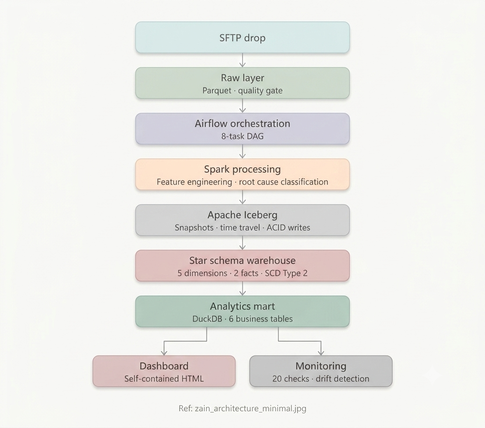
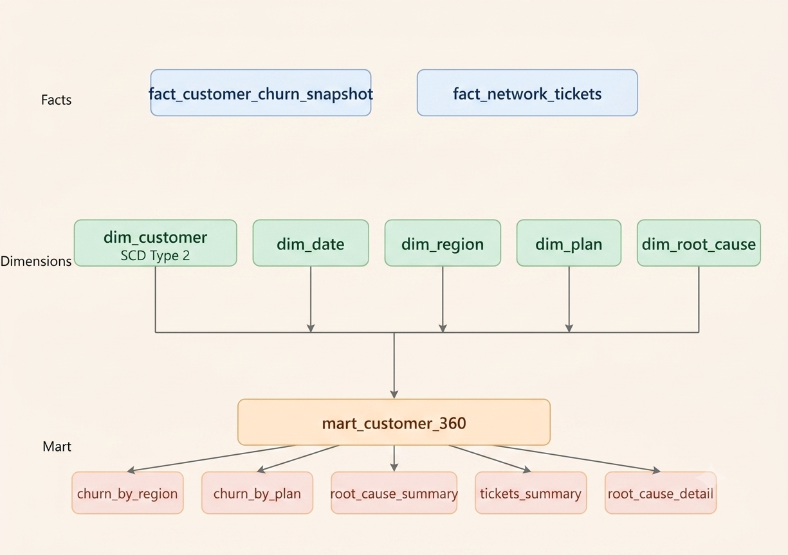
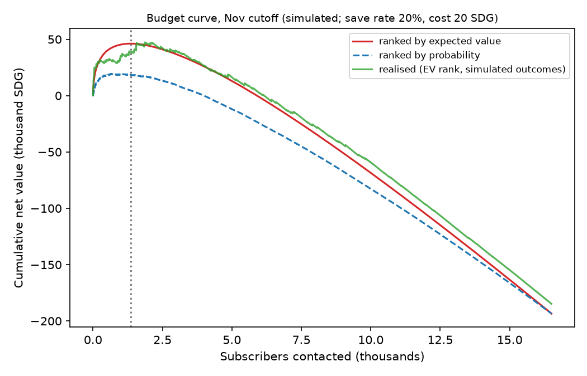
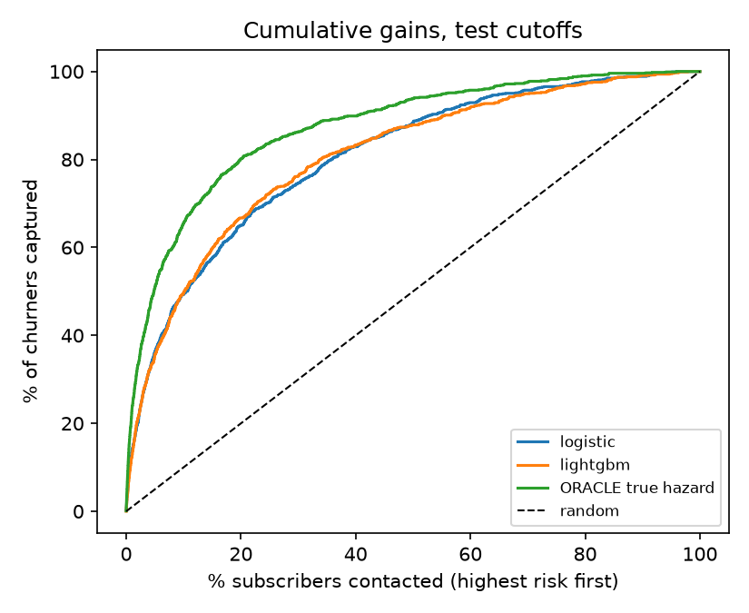

# Before They Go: Churn Early Warning

End-to-end churn early-warning system. Predicts who leaves next month, explains every score in English and Arabic, and turns the scores into a retention budget — LightGBM · SHAP · MLflow · Airflow · Spark · DuckDB

> All results use **simulated data** with a hidden churn process, so the model is graded against a known answer key. They demonstrate the method, not real-world performance.

## The Problem

Every telecom knows customers churn. The expensive mistake is finding out afterwards. A rule engine can say why a subscriber left; it cannot say who leaves next month, and a retention budget is always smaller than the subscriber base. This project scores every active prepaid and postpaid subscriber's chance of leaving next month, explains the score, and answers the question : **should we spend this month's budget on N subscribers, and which ones?**

## Objective

Build a churn model that is honest about how well it works: features that only see the past, evaluation on months the model never saw, probabilities that can be multiplied by money, and a decision layer that stops spending where the next contact no longer pays. The data platform underneath (ingestion, quality gate, star schema, monitoring) supplies the data and a rule-based root-cause classifier for comparison.

## Data Sources

- **Usage Events** — sessions per subscriber: customer_id, event_date, usage_type (data, voice, sms), usage_value
- **Billing Records** — monthly bills: customer_id, billing_month, amount_billed, amount_paid, payment_status, plan_type
- **Recharge Records** — top-ups (prepaid): customer_id, recharge_date, amount_sdg, channel
- **Network Tickets** — support tickets: ticket_id, customer_id, ticket_date, issue_type, status, resolution_days
- **Customers** — subscriber master: customer_id, region, plan_type, age, gender, activation_date, monthly_arpu_sdg

Phone numbers are hashed with a salt kept outside the repo. The generator's ground truth (true churn dates, hidden dissatisfaction, answer key) is used only to build the label and to validate, never as a feature.

## 🏗️ Data Architecture



Raw data lands as Parquet after SFTP ingestion, passes through a quality gate, gets enriched and classified by Spark, is persisted as an Iceberg table, modeled into a star schema, and served through a DuckDB mart. An Airflow DAG orchestrates every step.

On top of that, the model layer works in five steps: **as-of features** per subscriber per month-end → **churn panel** with a next-month label → **calibrated model** (logistic and LightGBM) → **scores with reasons** in English and Arabic → **budget decision**. A second Airflow DAG, `churn_scoring_monthly`, scores the base every month and checks for drift.

## 📐 Warehouse — Star Schema



`fact_customer_churn_snapshot` sits at the center with foreign keys to five dimension tables. The root cause key is the core analytical signal for the rule engine; the churn model reads the same raw layer and builds its own point-in-time panel.

## Key Design Decisions

- **Hidden-process data** — the first generator drew a persona and produced every table from it, so any model relearned the generator and scored about 1.0 AUC. The second draws churn from a hidden, evolving hazard, and an oracle ceiling shows how far the model is from the best possible score.
- **As-of features only** — every feature for a cutoff uses data up to that cutoff. A PySpark vs pandas parity test guards this, and banned columns (persona, label-anchored fields, raw phone number) are asserted in tests.
- **Out-of-time evaluation** — train on Mar-Jul, validate on Aug, test on Sep-Nov. The Kassala outage sits inside the test window, so the test is genuinely out of regime. Folds and bootstrap are grouped by subscriber.
- **Calibration on pooled out-of-fold scores** — fitting the calibrator on the August month alone over-predicted by about 18% in quieter months and was worse than no calibration. Pooling every matured month fixed it.
- **Expected value over probability** — `p × value × save rate − cost`. Ranking by expected value instead of probability alone is where the money is.
- **Rules to explain, model to predict** — the rule engine gives a human-readable reason after churn; the model ranks risk before it, and its reasons come from grouped SHAP values.
- **Iceberg over plain Parquet** — snapshot isolation, time travel, and idempotent overwrites. An Airflow retry cannot silently duplicate rows.
- **Two fact tables, not one** — churn snapshots and network tickets have different grains. Merging them silently inflates every aggregate.

Full rationale in `docs/architecture_decisions.md` and `docs/model_card.md`.

## What It Found

Out-of-time test on Sep-Nov, 988 churners in 50,604 subscriber-months (1.95% base rate):

- **0.81 ROC-AUC and about 5x lift** — the top 10% by risk reaches roughly half of the subscribers who then churn. The rule engine's thresholds, applied as of the same cutoff, reach only 0.63.
- **Logistic and LightGBM tie** — the planted signal is close to linear, so boosting adds nothing here. The model recovers about half of the oracle's PR-AUC (0.13 vs 0.28).
- **Contact about 8.9% of the base** (1,468 of 16,503 active subscribers at 2024-12-31). In the November backtest the value ranking realised **38,382 SDG**, against **16,458 SDG** for spending the same budget on the highest probabilities alone. The two lists share only 34% of names, because some high-risk subscribers are low value.
- **Counts are right, dollars run high** — the model expected 54 churners in the November list and 52 occurred, but expected net value still overstates the realised figure by about 17% in that quiet month. Plan on the realised number.
- **The model uses the planted drivers** — usage decline (43% of mean SHAP), unpaid bills (17%), recharge gaps (16%), new subscriber (12%) and network complaints (8%), each pushing risk in the planted direction.
- **The network hand-off finds the outages** — network share of at-risk subscribers is 32% in Nyala and 36% in Kassala during their planted outages, against 7% and 2% otherwise, and each ranks first nationally at every outage cutoff.
- **Regional caveat** — outages distort scores: Kassala is flagged at 52% of subscribers and over-predicted, Nyala at 34% and under-predicted. Age bands are even.

 

On this data the rule engine labels 99.1% of churners "behavioral" and 0.8% "network", so its split is not informative — one reason the predictive layer is worth having.

## Repository Structure

```
before-they-go/
├── churn_model/                → the data-science package
│   ├── as_of_features.py         point-in-time features (PySpark)
│   ├── build_panel.py            churn panel, label, salted hashing
│   ├── train.py  model.py        logistic + LightGBM, calibration, MLflow
│   ├── evaluate.py  explain.py   out-of-time results, SHAP, answer-key test
│   ├── reasons.py  decision.py   English/Arabic reasons, budget curve
│   ├── network_handoff.py        network share of risk by region
│   ├── score_monthly.py  drift.py  monthly scoring, PSI drift check
│   ├── fairness.py  pilot_sizes.py
│   ├── run_all.py                one command runs every step
│   └── tests/
├── src/                        → the data platform, one folder per stage
│   ├── 01_generate_data/         v1 persona data, v2 hidden-process generator
│   ├── 02_raw_ingest/            quality gate, quarantine, raw Parquet
│   ├── 03_orchestration/         local orchestrator, Airflow DAGs
│   ├── 04_classify_spark/        features, root-cause engine, Iceberg writer
│   ├── 05_star_schema/           warehouse build
│   ├── 06_analytics_mart/        DuckDB mart, exploration notebook
│   └── 07_monitoring/            pipeline health monitor
├── notebooks/                  → 01_eda_churn_panel.ipynb
├── dashboard/                  → churn_early_warning.html, churn_dashboard.html
├── docs/                       → model card, pilot design, director memo, and more
├── tests/                      → data-platform output tests
└── requirements.txt  run_pipeline.ps1  .env.example  LICENSE
```

## 🚀 Quick Start

```bash
# Install dependencies
pip install -r requirements.txt   # Python 3.12+ and Java 11+ required

# Generate the v2 data and build the platform layers (Windows PowerShell)
cd src/01_generate_data
python phase1b_generate_data.py --out ../data
cd ../..
.\run_pipeline.ps1 -SkipGeneration

# Run the churn model end to end (set a salt first, never commit it)
export CHURN_HASH_SALT="<secret>"        # PowerShell: $env:CHURN_HASH_SALT = "<secret>"
python -m churn_model.run_all

# Or open the dashboard directly (no server needed)
open dashboard/churn_early_warning.html   # Windows: just double-click the file
```

`run_all` resumes from any step with `--from train` and lists its steps with `--list`. Run the tests with `pytest tests churn_model/tests`.

## 📋 Requirements

- Python 3.12+
- Java 11+ (required for PySpark) — download from adoptium.net
- On Windows, `winutils.exe` under `C:\hadoop\bin` (see `run_pipeline.ps1`)
- See `requirements.txt` for the full package list

## 📚 Documentation

- [Model card](docs/model_card.md) — data, method, calibration, fairness, monitoring
- [Director memo](docs/director_memo.md) — the recommendation in English and Arabic
- [Pilot design](docs/pilot_design.md) — how to prove it works, with sample sizes
- [Fairness audit](docs/fairness_audit.md) · [Feature dictionary](docs/feature_dictionary.md) · [Results](docs/results.md)
- [BI data requirements](docs/bi_data_requirements.md) · [Architecture decisions](docs/architecture_decisions.md)

## License

MIT, see `LICENSE`.
